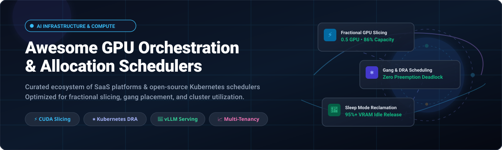

# Awesome-GPU-Orchestration-Allocation-Schedulers

  

  
  
  
  
  
  

## 🚀 Top GPU Orchestration & Allocation Schedulers Ecosystem

**A Curated Directory of SaaS Platforms & Open-Source Projects for GPU Fractioning, AI Workload Scheduling, Dynamic Resource Allocation (DRA), and Cluster Utilization.**

---

### 🌐 Sector Overview & Market Dynamics

The global AI GPU orchestration and workload management software market is estimated at **$4.04 billion in 2026** (growing at a ~28.3% CAGR), embedded within the broader **$75B+ AI infrastructure and GPUaaS market**. Market dynamics exhibit a distinct structural duality: while the underlying accelerator silicon and hyperscale compute layer remain **highly concentrated** (dominated by NVIDIA hardware and tier-1 hyperscalers), the orchestration, scheduling, and neocloud layer is **moderately fragmented and rapidly evolving**, with specialized independent clouds ("neoclouds") and Kubernetes-native open-source schedulers competing fiercely on cost efficiency, fractional slicing, gang scheduling, and sub-second scale-to-zero capabilities.

---

This repository tracks top-tier **SaaS platforms** and **open-source projects** in the GPU orchestration ecosystem. These tools enable AI/ML engineering organizations to maximize GPU utilization, eliminate compute idling during sporadic agent workflows, and share high-cost accelerators across teams through fractional allocation, gang scheduling, multi-instance slicing (MIG), and quota governance.

---

## 📑 Table of Contents

- [🌐 Sector Overview & Market Dynamics](#-sector-overview--market-dynamics)
- [☁️ SaaS & Hosted GPU Platforms](#️-saas--hosted-gpu-platforms)
- [💻 Open-Source GitHub Projects](#-open-source-github-projects)
- [🏗️ Key Architectural Concepts](#️-key-architectural-concepts)
- [⭐ Star History](#-star-history)
- [💖 Support & Community](#-support--community)
- [🤝 How to Contribute](#-how-to-contribute)
- [⚠️ Disclaimer](#️-disclaimer)

---

## ☁️ SaaS & Hosted GPU Platforms

*Platforms are sorted in descending order by estimated market valuation / scale.*

| Product | Scale & Valuation / Revenue | Pricing Model & Starting Tier Rates | Free Tier / Trial Limits | Key Orchestration Features |
| :--- | :--- | :--- | :--- | :--- |
| **[CoreWeave](https://www.coreweave.com/)** | **~$52B Market Cap** (~$12B–$13B 2026E Rev) | Fixed-node hourly billing (8-GPU min for SXM); PCIe H100 from **$4.25/GPU-hr**; HGX H100 from **$6.16/GPU-hr** ($49.24/node-hr); HGX B200 from **$8.60/GPU-hr**; $0 egress | **No free tier or public trial** (Dedicated enterprise onboarding and custom proof-of-concept credits via sales approval) | Automated node lifecycle management (**Mission Control**), clusters up to 42k GPUs, 3200Gbps InfiniBand, NVIDIA H200 & GB200 NVL72 clusters. |
| **[Crusoe Cloud](https://crusoe.ai/)** | **$30.9B Valuation** (~$2B 2026E Rev) | Per-minute on-demand billing; NVIDIA L40S from **$1.50/GPU-hr**; A100 (80GB) from **$2.00/GPU-hr**; H100 (80GB SXM) from **$3.90/GPU-hr**; $0 data egress | **$5 promotional signup credit** on select inference APIs; enterprise research compute grants upon request | Climate-aligned energy infrastructure, managed Kubernetes, high-throughput storage, unified VM and bare-metal cluster allocation. |
| **[Modal](https://modal.com/)** | **$15.75B Valuation** (~$300M+ ARR) | Per-second serverless execution; CPU from **$0.14/vCPU-hr**; T4 GPU from **$0.59/hr**; A10G from **$1.10/hr**; A100 (40GB/80GB) from **$2.10–$2.80/hr**; H100 from **$4.40/hr** | **Starter Plan: $30/month recurring free compute credits** every month (no credit card required upfront) | Serverless container execution with gVisor sandbox isolation, sub-second cold starts, scale-to-zero, elastic capacity up to 50k+ containers. |
| **[Together AI](https://together.ai/)** | **$8.3B Valuation** (~$1B ARR / Run-rate) | Pay-per-token API (e.g. Llama 3/DeepSeek from **$0.20/1M tokens**) or dedicated GPU clusters from **$3.50/GPU-hr**; Sandboxes from **$0.0446/vCPU-hr** | **No permanent free tier**; requires minimum prepaid deposit ($5–$15); up to **$50,000 in startup accelerator credits** for eligible teams | Dedicated GPU cluster orchestration, instant auto-scaling inference endpoints, kernel-optimized inference engine, multi-model serving. |
| **[Nebius AI Studio](https://nebius.com/)** | **~$57B Market Cap** (~$3.0B–$3.4B 2026E Rev) | Granular per-GPU hourly billing; Preemptible/spot GPUs from **$0.79/hr**; On-demand L40S from **$1.55/hr**; HGX H100 from **$3.85–$4.50/GPU-hr**; HGX H200 from **$5.40/GPU-hr** | **No perpetual free tier**; promotional starter credits granted upon business verification; managed proof-of-concept trials via sales | Managed Kubernetes with native **NVIDIA Run:ai** integration, validated 0.5 GPU fractional slicing delivering 77% throughput, multi-tenant cluster governance. |
| **[Lambda Labs](https://lambdalabs.com/)** | **~$5B–$12B Valuation** (~$1.5B 2026E Rev) | Per-minute on-demand billing; On-demand A10 from **$0.60/hr**; A100 SXM from **$1.89/hr**; H100 SXM from **$2.49–$2.99/GPU-hr**; $0 egress fees | **No permanent free tier**; promotional **$10 one-time signup credit** for new accounts to test instances | On-demand 1-click Jupyter instances, reserved 1-to-3-year clusters, InfiniBand multi-node networking, pre-installed NVIDIA CUDA stacks. |
| **[RunPod](https://www.runpod.io/)** | **$1.0B Valuation** (~$240M ARR) | Per-second billing; Community Cloud RTX 3090 from **$0.22/hr**; RTX 4090 from **$0.34/hr**; Secure Cloud A100 from **$1.89/hr**; H100 PCIe from **$1.99–$2.69/hr** | **No recurring free tier**; offers **$10 non-expiring introductory credit** upon account activation | Global community + secure cloud fleet, serverless worker endpoints with scale-to-zero, persistent network volumes, REST and GraphQL APIs. |
| **[Prime Intellect](https://www.primeintellect.ai/)** | **$1.0B Valuation** ($150M+ Raised) | Per-minute billing across aggregated clouds; starting tiers from **$0.14/hr** for consumer GPUs up to **$2.20–$3.30/GPU-hr** for H100 instances | **No permanent free tier**; offers competitive compute grants ($500 up to $100,000) for open-source AI researchers and builders | Decentralized GPU aggregation across worldwide datacenters, peer-to-peer compute protocols, fault-tolerant distributed training across heterogeneous nodes. |
| **[Shadeform](https://shadeform.ai/)** | **Seed Stage / YC S23** (Profitable boutique) | **$0 platform markup fee**; pay exact underlying cloud rates (aggregated across 30+ providers from **$0.20/GPU-hr** to top-tier SXM) | **Free-tier platform access forever** ($0 API platform cost); introductory credits and evaluation credits available via direct request | Multi-cloud unified API and dashboard, cross-cloud availability monitoring, live spot/on-demand price comparison, automated failover and instance spinning. |

---

## 💻 Open-Source GitHub Projects

*Production-grade open-source schedulers, Kubernetes operators, inference engines, and cluster managers. Sorted in descending order by GitHub Stars.*

| Project | Stars | Primary Focus / Description |
| :--- | :--- | :--- |
| **[vLLM](https://github.com/vllm-project/vllm)** |  | High-throughput, memory-efficient LLM serving engine. Features PagedAttention, continuous batching, chunked prefill, and Sleep Mode (releases up to 95%+ VRAM when idle). Pairs with schedulers for multi-model sharing. |
| **[Ray](https://github.com/ray-project/ray)** |  | Unified distributed compute framework. Ray Core, Ray Train, and Ray Serve provide dynamic actor placement, fractional GPU slicing per worker, and elastic multi-node orchestration. |
| **[DeepSpeed](https://github.com/deepspeedai/DeepSpeed)** |  | Extreme-scale deep learning optimization and distributed training engine by Microsoft. Implements ZeRO memory partitioning, pipeline parallelism, and efficient multi-GPU communication. |
| **[Kubeflow](https://github.com/kubeflow/kubeflow)** |  | Comprehensive cloud-native AI platform for Kubernetes. Provides Training Operator for multi-framework distributed training (PyTorch, TensorFlow, MPI), Katib tuning, and pipeline workflow orchestration. |
| **[Triton Inference Server](https://github.com/triton-inference-server/server)** |  | NVIDIA's enterprise-grade multi-model inference server. Dynamically orchestrates models across heterogeneous GPUs with concurrent model execution, dynamic batching, and model pipeline ensembles. |
| **[SkyPilot](https://github.com/skypilot-org/skypilot)** |  | Multi-cloud AI compute orchestration layer. Automatically benchmarks, finds cheapest GPU instances across AWS, GCP, Azure, Lambda, and RunPod, auto-stops idle clusters, and recovers preempted spot instances. |
| **[KEDA](https://github.com/kedacore/keda)** |  | Kubernetes Event-driven Autoscaling. Enables scale-to-zero and dynamic pod autoscaling based on GPU metrics, Prometheus queries, queue lengths, or HTTP traffic bursts. |
| **[BentoML](https://github.com/bentoml/BentoML)** |  | Unified AI application serving framework. Supports adaptive batching, multi-model GPU resource allocation, standalone worker scaling, and production deployment across Kubernetes. |
| **[Volcano](https://github.com/volcano-sh/volcano)** |  | CNCF Incubating batch scheduling system for high-performance AI/HPC workloads. Features gang scheduling, job queueing, fair-share scheduling, preemption, and GPU resource sharing. |
| **[Slurm](https://github.com/SchedMD/slurm)** |  | De facto HPC workload manager. Mature Generic Resource Scheduling (GRES) for physical GPUs, preemptable partitions, fair-share scheduling, and topology-aware multi-node MPI/NCCL placement. |
| **[NVIDIA Device Plugin](https://github.com/NVIDIA/k8s-device-plugin)** |  | Standard Kubernetes daemon exposing NVIDIA GPUs (`nvidia.com/gpu`) as schedulable cluster resources. Supports whole GPUs, Multi-Instance GPU (MIG) partitioning, and basic time-slicing. |
| **[Determined AI](https://github.com/determined-ai/determined)** |  | Open-source platform for distributed deep learning. Combines cluster scheduling, smart spot-instance management, automated fault tolerance, hyperparameter search, and GPU quota tracking. |
| **[Kueue](https://github.com/kubernetes-sigs/kueue)** |  | Official Kubernetes SIGs job queueing and quota controller. Manages multi-tenant resource quotas, dynamic borrowing, priority preemption, and workload admission control for GPUs and batch jobs. |
| **[NVIDIA GPU Operator](https://github.com/NVIDIA/gpu-operator)** |  | Automates provisioning and management of the entire NVIDIA software stack on Kubernetes: drivers, container toolkit, device plugin, Dynamic Resource Allocation (DRA) drivers, DCGM telemetry, and MIG configuration. |
| **[KubeRay](https://github.com/ray-project/kuberay)** |  | Official Kubernetes operator for Ray. Manages RayCluster, RayJob, and RayService CRDs. Implements head/worker separation, autoscaling with KEDA, and fractional GPU sharing for Ray Serve. |
| **[vLLM Production Stack](https://github.com/vllm-project/production-stack)** |  | Kubernetes-native reference architecture for production vLLM deployments. Provides intelligent request routing, automated horizontal pod autoscaling, caching routers, and cluster-wide metrics. |
| **[KAI Scheduler (NVIDIA)](https://github.com/kai-scheduler/KAI-Scheduler)** |  | High-performance open-source GPU scheduler for Kubernetes (Apache-2.0, CNCF Sandbox). Powers NVIDIA Run:ai. Offers gang scheduling, bin-packing, hierarchical queues, Dominant Resource Fairness (DRF), and DRA integration. |
| **[NVIDIA Run:ai Open Source Components](https://github.com/NVIDIA/run-ai)** |  | Open-source enterprise workload orchestration engine for Kubernetes. Integrates KAI Scheduler, fractional GPU drivers, multi-tenant department quotas, and workload mapping for distributed AI. |
| **[GPU Fractioning Operator (NVIDIA)](https://github.com/NVIDIA/k8s-gpu-fractioning-operator)** |  | CUDA-native fractional GPU allocation for Kubernetes. Enforces strict VRAM memory limits at the driver level, allowing multiple pods to safely share a single GPU with complete memory isolation. |
| **[NVIDIA DCGM](https://github.com/NVIDIA/DCGM)** |  | NVIDIA Data Center GPU Manager. Collects hardware-level telemetry, memory utilization, temperature, power draw, and throttle conditions; exports metrics to Prometheus and Grafana for scheduler awareness. |

---

## 🏗️ Key Architectural Concepts

Building or selecting an enterprise GPU scheduling architecture requires combining complementary layers:

1. **Infrastructure Automation Layer:** [NVIDIA GPU Operator](https://github.com/NVIDIA/gpu-operator) configures kernel drivers, container runtime hooks, and MIG profiles across nodes.
2. **Cluster Scheduling & Gang Placement:** [KAI Scheduler](https://github.com/kai-scheduler/KAI-Scheduler) or [Volcano](https://github.com/volcano-sh/volcano) guarantees gang scheduling (all $N$ distributed training pods start simultaneously or wait together, avoiding deadlocks).
3. **Fractional GPU Slicing & Isolation:** [GPU Fractioning Operator](https://github.com/NVIDIA/k8s-gpu-fractioning-operator) enforces strict CUDA driver-level VRAM bounds so lightweight models and notebooks share underutilized cards without risking Out-Of-Memory (OOM) crashes.
4. **Queue & Multi-Tenancy Governance:** [Kueue](https://github.com/kubernetes-sigs/kueue) and Run:ai resource contracts handle organizational quota borrowing, fair-sharing, and preemption.
5. **Dynamic Serving & Memory Reclamation:** [vLLM](https://github.com/vllm-project/vllm) with Sleep Mode releases 95%+ of VRAM when idle, while [KubeRay](https://github.com/ray-project/kuberay) orchestrates multi-replica autoscaling.

---

## 🌟 Star History

---

## 💖 Support & Community

Thank you for exploring this curated repository! If you find this resource valuable for your AI infrastructure, ML platform engineering, or GPU optimization initiatives, please consider supporting the project:

- ⭐ **Star** this repository to keep up with the latest GPU scheduling tools and platform updates.
- 🍴 **Fork** and contribute your own benchmarks, guides, and tools.
- 📢 **Share** with fellow MLOps, DevOps, and AI infrastructure teams on Twitter/X, LinkedIn, and Discord.
- ☕ **Buy a Coffee / Sponsor**: Support ongoing maintenance and curation via the [GitHub Sponsors Dashboard](https://github.com/sponsors/ishandutta2007).

---

## 🤝 How to Contribute

1. 🍴 Fork this repository.
2. 🌿 Create a new branch: `git checkout -b add-gpu-tool`.
3. 📝 Add the project or platform to the appropriate table matching the existing format:
   - For SaaS products: include pricing details, free tier/trial limits, and scale/valuation.
   - For Open-Source projects: include the official repo link, star badge (`style=social&color=white`), and functional description.
4. ✅ Keep entries objective, verified, and linked to authoritative sources.
5. 🚀 Submit a pull request.

---

## ⚠️ Disclaimer

- This is a community-curated educational and technical resource; inclusion does not constitute endorsement.
- All valuations, pricing rates, and free tier allowances are collected from published rate cards, filings, and industry sources as of October 2026 and may change.
- Operating production GPU clusters requires strict authentication, encryption, and telemetry monitoring to protect high-cost computing hardware.

---

**Maintained with ❤️ for ML platform teams, AI infrastructure engineers, and systems architects building high-utilization GPU clusters.**
